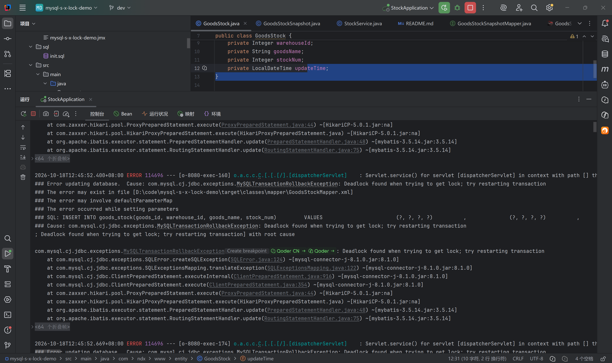
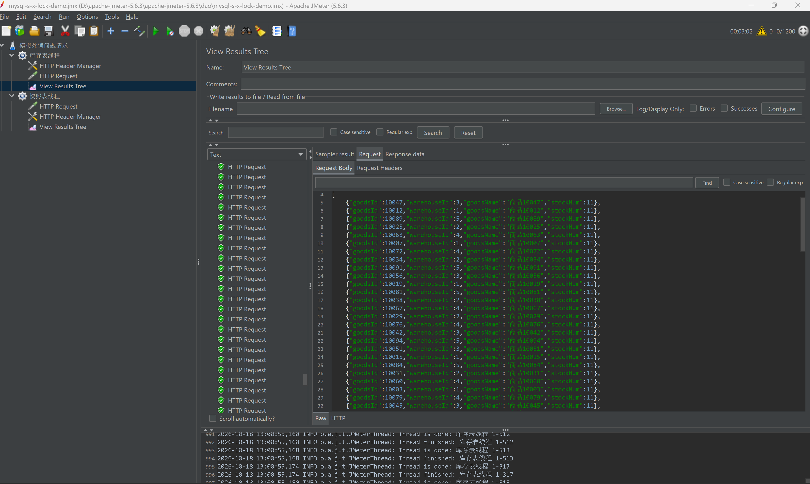

# mysql-s-x-lock-demo

一个用于复现和讲解 MySQL 死锁原理的 Demo 项目：在 **RR（REPEATABLE-READ）隔离级别**下，`INSERT INTO A SELECT ... FROM B` 与批量 `INSERT ... ON DUPLICATE KEY UPDATE` 并发执行时，因对 B 表（`goods_stock`）加锁顺序冲突而形成死锁环。

> 技术栈：Java 21 / Spring Boot 3.2 / MyBatis / MySQL InnoDB / JMeter
> 作者：ndx

---

## 1. 业务场景

库存系统中两张表（见 [sql/init.sql](sql/init.sql)）：

| 表 | 角色 | 主键 | 说明 |
|----|------|------|------|
| `goods_stock` | B 表（基准表） | 联合主键 `(goods_id, warehouse_id)` | 商品仓库库存，入库时 upsert 累加 |
| `goods_stock_snapshot` | A 表（快照表） | 自增 `id` | 定时保存 B 表当前库存的快照 |

两个接口（见 [StockController.java](src/main/java/com/ndx/www/controller/StockController.java)）：

- **接口1** `POST /stock/snapshot`：生成库存快照，把 B 表数据写入 A 表
- **接口2** `POST /stock/batch-upsert`：商品入库，批量 upsert B 表（业务层用 `synchronized` 锁 mapper）

两个接口操作的是同一张 B 表，高并发下会触发死锁。

---

## 2. 死锁发生的原理（核心）

### 2.1 两条 SQL 的加锁行为

**接口1 原 SQL（死锁版本）**，见 [GoodsStockSnapshotMapper.xml](src/main/resources/mapper/GoodsStockSnapshotMapper.xml) 中的 `insertSnapshotFromB`：

```sql
INSERT INTO goods_stock_snapshot(goods_id, warehouse_id, goods_name, stock_num)
SELECT goods_id, warehouse_id, goods_name, stock_num FROM goods_stock
```

在 RR + `binlog_format=STATEMENT` 下，这条 SQL 会加两类锁：

1. **B 表扫描行的共享 next-key 锁（S 锁 = 记录锁 + 间隙锁）**。原因：基于语句的 binlog 要求重放时结果集一致，所以 SELECT 部分必须锁住扫描到的所有行和间隙，防止其他事务在执行期间修改 B 表；
2. **A 表新插入行的排他锁（X 锁）+ AUTO-INC 自增锁**（bulk insert 场景下自增锁是表级锁，语句结束才释放）。

**接口2 SQL**，见 [GoodsStockMapper.xml](src/main/resources/mapper/GoodsStockMapper.xml) 的 `batchUpsertStock`：

```sql
INSERT INTO goods_stock(...) VALUES (...),(...)
ON DUPLICATE KEY UPDATE stock_num = stock_num + VALUES(stock_num), ...
```

对批量中的每一行做唯一键冲突检查：

- 行**已存在**：需要对该行加**排他记录锁（X 锁）**后执行更新；
- 行**不存在**：加**插入意向锁**，且重复键检查会涉及**间隙锁**。

### 2.2 死锁时序

设 B 表存在行 R1、R2，接口2 的批量参数顺序为 R1 → R2：

| 时刻 | 事务 T1（接口1 快照） | 事务 T2（接口2 入库） |
|------|----------------------|----------------------|
| t1 | — | 执行 upsert，对 R1 加 X 锁成功并更新 |
| t2 | 执行 `INSERT INTO A SELECT FROM B`，扫描 B 表，**已持有 R2 的 S next-key 锁** | — |
| t3 | 扫描到 R1，申请 S(R1) → 被 T2 的 X(R1) 阻塞，**T1 等待** | — |
| t4 | — | 处理批量第 2 行 R2，申请 X(R2) → 被 T1 的 S(R2) 阻塞，**T2 等待** |
| t5 | **死锁环形成** | **死锁环形成** |

死锁环：

```
T1 持有 S(R2)  ──等待──▶  T2 持有的 X(R1)
T2 持有 X(R1)  ──等待──▶  T1 持有的 S(R2)
```

T1 和 T2 **加锁顺序相反**（T1 按扫描顺序 R2→R1 加 S 锁，T2 按参数顺序 R1→R2 加 X 锁），各自持有对方需要的锁，形成循环等待。InnoDB 死锁检测发现环后，选择回滚代价较小的事务（undo 量少的一方），另一方抛出：

```
ERROR 1213 (40001): Deadlock found when trying to get lock; try restarting transaction
```

### 2.3 为什么 `synchronized` 挡不住

[StockService.java](src/main/java/com/ndx/www/service/StockService.java) 中接口2 用 `synchronized(goodsStockMapper)` 加了 JVM 本地锁，但它只对死锁环的"半边"有效：

- 它只能串行化**接口2 自身**的并发请求，接口1 走完全不同的调用链，不受该锁约束，仍会与接口2 争抢 B 表行锁；
- 多实例部署时 `synchronized` 形同虚设（需分布式锁）。

所以即使加了 `synchronized`，接口1 与接口2 并发时依然死锁。

### 2.4 复现前提（重要）

MySQL 8.0 默认 `binlog_format=ROW`，该格式下 `INSERT ... SELECT` 的 SELECT 部分走一致性非锁定读（MVCC 快照读），**不会对 B 表加 S 锁**，死锁不会复现。复现本 Demo 需切换为基于语句的 binlog：

```sql
SET GLOBAL binlog_format = STATEMENT;
SET GLOBAL transaction_isolation = 'REPEATABLE-READ';
```

设置后需重新建立连接（重启应用）才生效。

### 2.5 死锁现场（复现证据）

JMeter 并发压测后，接口2（upsert）被 InnoDB 选为牺牲者回滚，应用日志实锤死锁：



关键日志文本：

```text
### Error updating database.  Cause: com.mysql.cj.jdbc.exceptions.MySQLTransactionRollbackException
    : Deadlock found when trying to get lock; try restarting transaction
### The error may exist in file [D:/code/mysql-s-x-lock-demo/target/classes/mapper/GoodsStockMapper.xml]
### SQL: INSERT INTO goods_stock(goods_id, warehouse_id, goods_name, stock_num)
        VALUES (?,?,?,?),(?,?,?,?),(?,?,?,?)
### Cause: com.mysql.cj.jdbc.exceptions.MySQLTransactionRollbackException
    : Deadlock found when trying to get lock; try restarting transaction
```

从日志可以印证三件事：

1. **死锁检测生效**：错误码 1213 (40001)，InnoDB 发现死锁环后主动回滚了其中一个事务；
2. **被回滚的是接口2（upsert）**：报错 SQL 来自 `GoodsStockMapper.xml` 的 `batchUpsertStock`，说明快照事务（T1）先持有 B 表 S 锁，InnoDB 按 undo 量把批量 upsert 事务选为牺牲者；
3. **批量 3 行 VALUES**：多行批量是死锁的关键放大器——单行 upsert 几乎成不了环，行数越多，T2 越容易与 T1 的扫描顺序形成交叉持锁。

### 2.6 InnoDB 官方死锁报告（最强证据）

死锁发生后立即执行 `SHOW ENGINE INNODB STATUS\G`，`LATEST DETECTED DEADLOCK` 段落完整记录了死锁现场（完整原始报告见 [docs/innodb-deadlock-report.txt](docs/innodb-deadlock-report.txt)）。下面是删掉逐条记录锁十六进制明细后的关键骨架（另一轮压测，批量 16+ 行）：

```text
*** (1) TRANSACTION:
TRANSACTION 648149, ACTIVE 0 sec inserting                   ← 接口2：批量 upsert
LOCK WAIT 3 lock struct(s), 2 row lock(s), undo log entries 1
INSERT INTO goods_stock(goods_id, warehouse_id, goods_name, stock_num)
        VALUES (10047,3,...), (10012,1,...), (10089,5,...) ...

*** (1) HOLDS THE LOCK(S):
RECORD LOCKS ... index PRIMARY of `stock_db`.`goods_stock`
    lock_mode X locks rec but not gap                        ← X 纯记录锁（不含间隙）
Record lock, heap no 22 ... [10047, 3]                       ← 已持有 (10047,3) 的 X 锁

*** (1) WAITING FOR THIS LOCK TO BE GRANTED:
RECORD LOCKS ... lock_mode X locks rec but not gap waiting
Record lock, heap no 23 ... [10012, 1]                       ← 在等 (10012,1) 的 X 锁

*** (2) TRANSACTION:
TRANSACTION 648148, ACTIVE 1 sec fetching rows               ← 接口1：INSERT INTO A SELECT FROM B
LOCK WAIT 4 lock struct(s), 62 row lock(s), undo log entries 61
INSERT INTO goods_stock_snapshot(...)
        SELECT goods_id, warehouse_id, goods_name, stock_num FROM goods_stock

*** (2) HOLDS THE LOCK(S):
RECORD LOCKS ... index PRIMARY of `stock_db`.`goods_stock`
    lock mode S                                              ← S next-key 锁（记录+间隙）
Record lock, heap no 2  ... [1001,  1]                       ← 已持有 62 行的 S 锁，其中就有 ↓
Record lock, heap no 23 ... [10012, 1]                       ← (10012,1) 的 S 锁在事务(2)手里
...（共 62 条记录锁明细）

*** (2) WAITING FOR THIS LOCK TO BE GRANTED:
RECORD LOCKS ... lock mode S waiting
Record lock, heap no 22 ... [10047, 3]                       ← 在等 (10047,3) 的 S 锁

*** WE ROLL BACK TRANSACTION (1)                             ← InnoDB 回滚了 upsert 事务
```

死锁环的实物证据（两个事务的 HOLDS 与 WAITING FOR 精确互指对方）：

```text
事务(1) upsert：持 X(10047,3) ──等待──▶ X(10012,1)，被事务(2)的 S 锁挡住
事务(2) 快照  ：持 S(10012,1) ──等待──▶ S(10047,3)，被事务(1)的 X 锁挡住   → 死锁环
```

几个值得品读的细节：

1. **锁模式差异**：upsert 的 X 锁显示 `locks rec but not gap`（已存在行 update 只加纯记录锁）；快照的 S 锁显示 `lock mode S`（无 but not gap，即 **next-key 锁 = 记录 + 间隙**），与 2.1 节的分析完全一致；
2. **回滚对象印证**：upsert 仅 1 条 undo，快照已写入 61 条，InnoDB 回滚代价更小的事务(1)——正好是接口2，与 2.5 节应用日志吻合；
3. **进度可见**：快照事务 `undo log entries 61` 说明已扫完写入 61 行、卡在第 62 行；upsert 第 1 行 (10047,3) 加 X 锁成功、第 2 行 (10012,1) 被卡——完整还原 2.2 节的时序表；
4. **行级归属**：heap no 22 记录的第 3 字段（DB_TRX_ID）为 `0x9e3d5` = 648149，正是事务(1)自己——证明 (10047,3) 刚被 upsert 修改过，X 锁因此归它。记录第 1 字段 `0x273f` 即 goods_id 10047（BIGINT 带 `0x80` 符号位前缀）。

---

## 3. 修复方案

### 3.1 已应用的修复（当前代码）

把 `INSERT INTO A SELECT FROM B` 一条语句拆成两步，**让快照过程对 B 表全程零加锁**（见 [StockService.java](src/main/java/com/ndx/www/service/StockService.java)）：

```java
// Step1：RR 下普通 SELECT 是 MVCC 快照读，不加任何行锁
List<GoodsStock> stockAllList = goodsStockSnapshotMapper.selectAll();

// Step2：应用拿到内存数据后，纯 VALUES 批量插入 A 表
if (!stockAllList.isEmpty()) {
    goodsStockSnapshotMapper.batchInsert(stockAllList);
}
```

死锁环需要双方同时持有 B 表上的锁，B 表零锁后"半边"消失，死锁从结构上不可能发生。完整变更记录见根目录补丁文件 [fix__将insert_into_select_语法改成业务层查询后再插入解决死锁问题.patch](fix__将insert_into_select_语法改成业务层查询后再插入解决死锁问题.patch)（反向应用该 patch 即可还原死锁版本用于复现）。

**Trade-off**：SELECT 与 INSERT 之间 B 表数据可能变化，快照不再是严格"单一时刻"的一致性数据，对快照场景通常可接受；若要求严格一致，可改用 binlog_format=ROW 下的原 SQL，或把快照任务与入库任务在时间上错峰。

**修复后验证**：应用修复代码后，用同一个 [JMeter 脚本](jmeter-file/mysql-s-x-lock-demo.jmx)以相同并发再压一轮，**1200 个请求全部成功、0 错误**，接口1 与接口2 全绿，日志中不再出现 1213 死锁错误：



死锁的前后对比：修复前 = 2.5 节控制台 1213 报错 + 2.6 节 InnoDB 死锁报告；修复后 = 本图 0 error。

### 3.2 其他可选方案

| 方案 | 说明 | 局限 |
|------|------|------|
| `binlog_format=ROW` | `INSERT...SELECT` 不再锁源表 | 需评估主从复制方式变更影响 |
| 隔离级别降为 RC | 无间隙锁，普通读不加锁，冲突窗口大幅缩小 | `INSERT...SELECT` 仍会加 S 记录锁，未根治 |
| 捕获 1213 异常重试 | 兜底手段，死锁回滚后重试 | 治标不治本，高并发下重试风暴 |
| 调度层错峰 | 快照任务与入库高峰隔离，或分布式锁互斥 | 增加架构复杂度 |

---

## 4. 运行与复现

1. 建库建表：先 `CREATE DATABASE stock_db DEFAULT CHARSET utf8mb4;`，再执行 [sql/init.sql](sql/init.sql)
2. 设置复现前提（见 2.4 节）：`binlog_format=STATEMENT` + RR 隔离级别
3. 修改 [application.yml](src/main/resources/application.yml) 中的数据库连接信息
4. 还原死锁版本：将 `createStockSnapshot()` 改回调用品 `goodsStockSnapshotMapper.insertSnapshotFromB()`
5. 启动应用：

```bash
mvn spring-boot:run
```

6. 并发压测两个接口（可用 [jmeter-file/mysql-s-x-lock-demo.jmx](jmeter-file/mysql-s-x-lock-demo.jmx)），或用 curl 手动并发：

```bash
# 接口1：快照
curl -X POST http://localhost:8080/stock/snapshot

# 接口2：批量入库
curl -X POST http://localhost:8080/stock/batch-upsert \
  -H "Content-Type: application/json" \
  -d '[{"goodsId":1001,"warehouseId":1,"goodsName":"无线鼠标","stockNum":50},{"goodsId":1002,"warehouseId":1,"goodsName":"机械键盘","stockNum":20}]'
```

7. 观察死锁：应用日志出现 `Deadlock found when trying to get lock`，或执行 `SHOW ENGINE INNODB STATUS` 查看 `LATEST DETECTED DEADLOCK` 段落中两个事务持有的锁与等待链。

---

## 5. 项目结构

```
mysql-s-x-lock-demo
├── sql/init.sql                          # 建表脚本（A 快照表 + B 库存表）
├── jmeter-file/mysql-s-x-lock-demo.jmx   # JMeter 并发压测脚本
├── docs
│   ├── images/deadlock-console.png       # 死锁复现控制台日志截图
│   ├── images/jmeter-all-success.png     # 修复后 JMeter 全部成功截图
│   └── innodb-deadlock-report.txt        # InnoDB 官方死锁报告原文
├── fix__*.patch                          # 死锁修复补丁（业务层查询后插入）
└── src/main/java/com/ndx/www
    ├── controller/StockController.java   # 两个演示接口
    ├── service/StockService.java         # 业务逻辑（含修复后实现）
    ├── mapper/                           # MyBatis Mapper 接口
    └── entity/                           # GoodsStock / GoodsStockSnapshot
```
